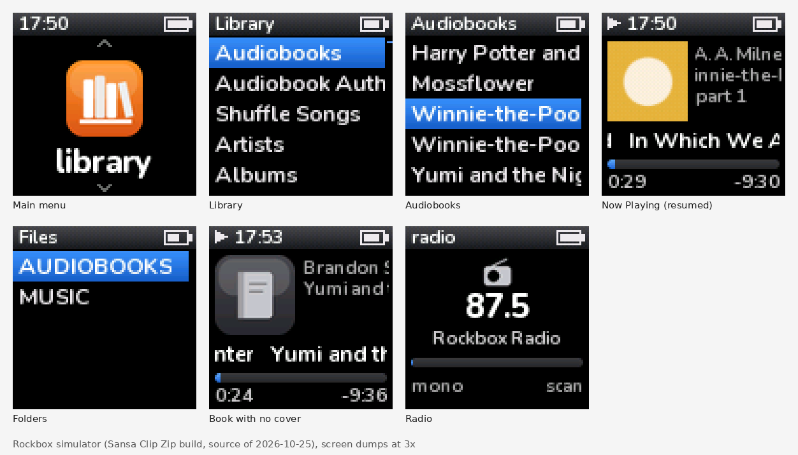
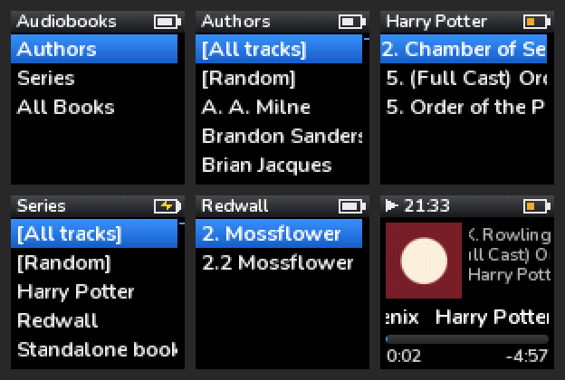

# ZipStock

A Rockbox theme for the SanDisk Sansa Clip Zip (96x96 colour) that looks like the stock firmware, plus database menus for audiobooks: by author, by series, and all books. It works with the tags the books already have; nothing needs to be added to them.




All screenshots are screen dumps from the Rockbox simulator for the Clip Zip.

## What's here

| Path | What it is |
| --- | --- |
| `theme/.rockbox/` | The theme. Copy it onto the player's own drive, merging with the `.rockbox` folder there. |
| `INSTALL.txt` | The plain-text install notes that ship inside the zip. |
| `tools/` | How the theme was made: `ttf2fnt.py` (TTF to Rockbox anti-aliased `.fnt`), `images.py` (draws the bitmaps), `checkskin.py` (static check of the skins), `keyremap.py` (writes `keyremap.kmf`), `sim.sh` (drives a Rockbox simulator under Xvfb). |
| `build.sh` | Builds `zipstock-theme.zip` (the theme plus INSTALL.txt) for release. |
| `.github/workflows/` | CI checks every push; a `v*` tag publishes the zip as a release. |

## Install

You need a Clip Zip already running Rockbox, and a Mac or PC to copy files.

1. **Get the files.** Download `zipstock-theme-<version>.zip` from [Releases](../../releases), or clone this repo and run `./build.sh`. Unzip it.
2. **Copy the theme.** Plug in the player and copy the `.rockbox` folder onto the player's own drive (not the microSD card), merging it with the `.rockbox` folder already there. Nothing of Rockbox's is replaced. On a Mac, Finder hides dot folders; press Cmd+Shift+. to show them.
3. **Pick the theme.** Eject, then on the player: Settings > Theme Settings > Browse Theme Files > `zipstock`.
4. **Load the settings.** Settings > General Settings > Manage Settings > Browse .cfg Files > `zipstock-setup`. It sets the main menu, autoresume, bookmarks and faster scrolling. Don't load `simple.cfg` after it: that turns icons off, and the main menu pictures come from the icons.
5. **Build the database.** On the player: Settings > General Settings > Database > Initialize Now. It scans in the background; give it a few minutes for a big library. Then turn the player off and on. At boot it asks to finish the database: press Select or wait 5 seconds (any other button says no). After that it updates itself at boot when files change.
6. **Browse.** Main menu > library > Audiobooks:
   - **Authors**: author, then their books. A book in a series starts with its series and number, so a series lists in order: "Harry Potter #5; Wizarding World #5: Harry Potter and the Order of the Phoenix".
   - **Series**: each series and number, then the book (both editions, if you have two)
   - **All Books**: every book by name

### How books are found

- A file counts as an audiobook when its path has a folder named `AUDIOBOOKS` or it ends in `.m4b`. Music menus leave those files out.
- Books are listed by their album tag (the book title in normal audiobook files), or by file name when there is none. A book in several files gets one line per file: "Book", "Book, part 2".
- Series come from the grouping tag. Audiobookshelf writes it when you run its **Embed Metadata** tool on a book, as `Harry Potter #5; Wizarding World #5` ([source](https://github.com/advplyr/audiobookshelf/blob/master/server/utils/ffmpegHelpers.js)). Only groupings with a `#` count as series, because Rockbox fills an empty grouping with the track title. Books without one still show under their author, by title.
- Each book resumes where you left it, however you open it.

### The back button

`keyremap.kmf` makes the back button work as on the stock firmware: a short press goes back one screen, holding it goes to the main menu. Only that button changes, and only in lists and menus; Left still goes back too. Rockbox checks the file against its own build at start-up and refuses it with a "key remap failed" message if its action numbers differ (then delete the file). `tools/keyremap.py` writes it.

### Covers

Rockbox shows embedded JPEG covers, or `cover.jpg` / `folder.jpg` beside the file. It can't show PNG or progressive JPEG; those books get a plain book picture.

### Undo

- Theme: Settings > Theme Settings > Browse Theme Files > `cabbiev2`.
- Database menus: delete `/.rockbox/tagnavi_user.config`.
- Back button: delete `/.rockbox/keyremap.kmf` and restart.

## Rebuilding the assets

```sh
pip3 install pillow
python3 tools/images.py theme/.rockbox/wps/zipstock
python3 tools/ttf2fnt.py Nunito[wght].ttf theme/.rockbox/fonts
python3 tools/checkskin.py <rockbox source> theme theme/.rockbox/wps/zipstock.{sbs,wps,fms}
```

`Nunito[wght].ttf` is the variable font from Google Fonts.

## Notes on Rockbox's database menus

Found while testing `tagnavi_user.config` in the simulator:

- In a `%format` condition, clauses are joined by spaces. An `&` silently ends the condition.
- An empty tag compares as `<Untagged>`. Stock `tagnavi.config` tests for `[Untagged]`, which never matches.
- A missing track number is stored as -1.
- `[All tracks]` and `[Random]` are added to every list above the title level; a config can't remove them.
- A `%format` condition on a text tag only works if the list's own search has opened that tag, or the database is in RAM. Otherwise the check silently fails. The book menus carry always-true clauses (`album !~ "~~~"`) to open the tags their formats test.
- An empty grouping is stored as the track title.

## Releasing

```sh
git tag v1.0.0 && git push origin v1.0.0          # release
git tag v1.0.0-beta.1 && git push origin v1.0.0-beta.1   # prerelease
```

Or run **Release** from the Actions tab, naming the tag; it creates the tag at
the commit it builds. The Release workflow runs the same checks as CI, then publishes
`zipstock-theme-<tag>.zip` on a GitHub release. CI checks every push:

- the skins against the tag table of the Rockbox source the theme was tested
  on (`ROCKBOX_SHA` in `.github/workflows/ci.yml`);
- `keyremap.kmf` byte for byte against what `tools/keyremap.py` writes;
- that the zip holds every file the install notes name.

It does not run the simulator: the screenshots come from it, but the run is
by hand (`tools/sim.sh`).

## Licence

The fonts are Nunito, under the SIL Open Font License (`theme/.rockbox/fonts/Nunito-OFL.txt`).
